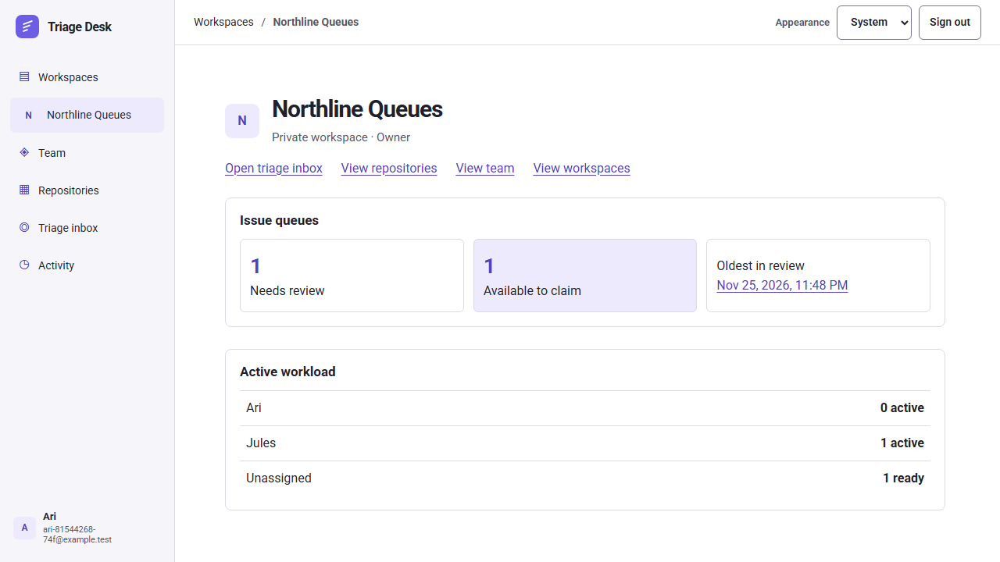
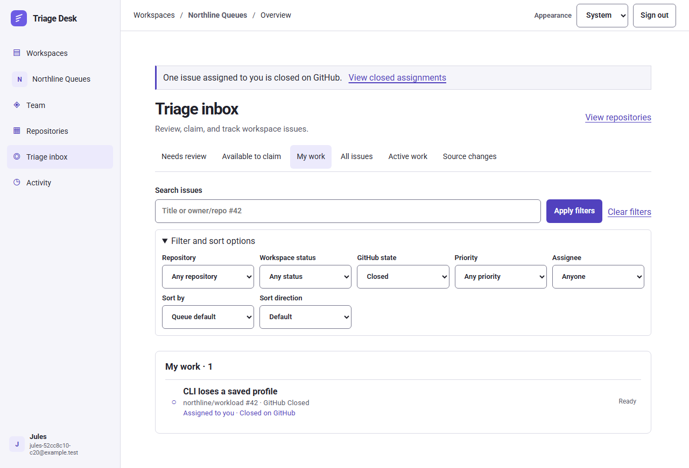

# Triage Desk

A private workspace for teams that triage public GitHub issues. The current app supports verified sign-in, team management, public repository connections, manual issue refresh, and the handoff from Reviewer to Member.

Read the [case study and measured evidence](docs/portfolio.md), [system and data diagrams](docs/system-and-data.md), and [API reference](docs/api-reference.md).





## Local setup

You need Node.js 24, the .NET 10 SDK listed in `global.json`, and PostgreSQL 18. The commands below use Docker Compose and PowerShell.

```powershell
docker compose up -d --wait postgres
dotnet tool restore
dotnet build
$env:ConnectionStrings__TriageDesk = 'Host=127.0.0.1;Port=55432;Database=triage_desk;Username=postgres;Password=local-triage-desk'
dotnet ef database update --project apps/api/TriageDesk.Api --no-build
dotnet run --project tools/LocalCertificate.csproj -- .local
npm ci --prefix apps/web
```

A native PostgreSQL 18 installation also works. Create a local database and set the same connection variable to use its host, port, and credentials.

Run the API from the repository root.

```powershell
$env:ASPNETCORE_ENVIRONMENT = 'Development'
$env:ASPNETCORE_URLS = 'https://127.0.0.1:5100'
$env:Kestrel__Certificates__Default__Path = Join-Path $PWD '.local/localhost.pem'
$env:Kestrel__Certificates__Default__KeyPath = Join-Path $PWD '.local/localhost.key'
$env:ConnectionStrings__TriageDesk = 'Host=127.0.0.1;Port=55432;Database=triage_desk;Username=postgres;Password=local-triage-desk'
$env:Identity__InboxDirectory = Join-Path $PWD '.local/inbox'
$env:Identity__KeyDirectory = Join-Path $PWD '.local/keys'
$env:Identity__WebOrigin = 'https://localhost:3000'
dotnet run --no-launch-profile --project apps/api/TriageDesk.Api
```

Run the web app in a second terminal.

```powershell
Set-Location apps/web
npm run dev -- --hostname 127.0.0.1 --experimental-https --experimental-https-cert ../../.local/localhost.pem --experimental-https-key ../../.local/localhost.key --experimental-https-ca ../../.local/localhost-ca.pem
```

Open [local Triage Desk](https://localhost:3000) and accept the local certificate in your browser. Register, open the matching JSON message in `.local/inbox`, and paste its `url` into the browser to confirm your address. The inbox and keys contain local credentials and are ignored by Git. Use a synthetic email address. Hosted email delivery is planned for the release slice.

Open a workspace and select **Team**. Create an invitation for a specific email and choose Member or Reviewer. Copy the private link and open it in a separate browser session. Sign in or verify a new account with that email in the tab where you opened the link, then accept the invitation. The link expires after seven days. The Owner can change roles, revoke pending links, remove teammates, and transfer ownership before leaving.

As Owner, open **Repositories**, enter `owner/repository`, preview the public repository, and connect it. An Owner or Reviewer can select **Refresh issues**. The screen shows the examined and imported counts and the last successful refresh. Open **Triage inbox** to see the reports in **Needs review** and select one for its GitHub details. Members can read the inbox and issue detail. Disconnecting hides the source from the inbox and preserves the workspace's triage record.

As Reviewer, accept an issue with a priority and next step. As Member, select **Available to claim**, claim the issue, then open **My work** to start it and mark it **Done**. In the Reviewer session, reload and select **All issues → Done** to see the workspace status, GitHub observation, assignee, and dated decision history.

Use **Request information** to send a question to an active teammate. The assignee answers from **My work**, and the issue returns to **Needs review** with the question and answer in history. Reviewers can assign or reassign work, set it aside with a reason, return deferred or completed work to review, and adjust priority or eligible severity. A GitHub label that exactly matches `bug`, ignoring case, makes a report eligible for severity. A stale decision displays the latest saved version with the unsaved draft still visible.

If a refresh tab closes, an Owner or Reviewer can select **Resume refresh** from Repositories and continue from the last saved batch. The last successful refresh updates only when the entire run succeeds. The **Source changes** inbox view shows reports that closed during active work, reopened after a workspace decision, or have conflicting transfer records.

Open the workspace overview to see **Needs review**, **Available to claim**, the oldest issue in review, and each teammate's active workload. Select a count to open the issues behind it. Search the inbox by title, short repository and issue number, or full repository and issue number. The URL preserves filters, sorting, page, and the selected issue. **Activity** shows private issue history across the workspace and can be filtered by repository.

When a manual refresh finds that GitHub closed an active assignment, the assignee sees an in-app notice that opens **My work** filtered to closed assignments. The notice follows the latest public observation and current assignment.

## Verify the slice

Stop the manually started API and web servers before running Playwright. It starts the API, Next.js and a local GitHub fixture that serves two pages for `northline/cli` and three for `northline/refresh`. Keep PostgreSQL running. In the terminal used for API tests, set `ConnectionStrings__TriageDesk` to the migrated local database. If you use `TRIAGEDESK_EXTERNAL_SERVERS=1`, run `node e2e/github-fixture.mjs` from `apps/web` and set `GitHub__FixtureOrigin=http://127.0.0.1:5101` on your Development API.

```powershell
dotnet test
npm run typecheck --prefix apps/web
npm run build --prefix apps/web
Set-Location apps/web
npx playwright install chromium
npm run test:e2e
```

The browser tests cover sign-in and private workspaces, team access, public issue import, the Member-to-Reviewer handoff, the question-and-answer flow with a stale edit, and refresh resumption in a separate Reviewer session. The handoff uses separate authenticated browser sessions and checks for zero GitHub requests during the workflow. PostgreSQL integration tests exercise rollback and replay, overlapping refresh requests, quota pauses, source visibility, transfers, and compatibility with earlier command receipts.

## Architecture

```text
Browser over HTTPS → Next.js /api/v1 adapter → ASP.NET Core Identity and workspace endpoints → PostgreSQL 18
```

Next.js relays the API's host-only session and antiforgery cookies. The API verifies the session and looks up the caller's current workspace membership. The first migration adds a deferred owner-membership foreign key so PostgreSQL enforces that each workspace has a corresponding owner membership when creation commits.

Team writes lock the workspace row, check current authorization, and commit membership or invitation changes with their audit entry. The database stores invitation digests and enforces one pending invitation per normalized email in a workspace. The API hides old invitations after the retention window and purges aged rows when issuing invitations in that workspace.

Manual refresh fetches one page or up to three known issue records per batch after checking the public repository identity. The first refresh scans open issues. Later refreshes fetch all states with a five-minute overlap from the last completed run's cutoff, then recheck known records that need confirmation. Each batch and its checkpoint commit together. Confirmed loss of public access scrubs affected source copies across workspaces and preserves private triage. Verified transfers to connected repositories retain the local issue and decision history.

The API serializes workspace decisions with membership changes. It checks the expected version and stores the command, decision version, and history in one transaction. A matching authorized replay returns the current triage.

The v1 contract in `contracts/openapi/v1.json` describes 38 operations. The API integration suite compares its registered paths and methods against the contract. Regenerate the web transport types with `npm ci --prefix contracts` followed by `npm run generate --prefix contracts`. The generator uses its own pinned TypeScript version. The web app builds with TypeScript 7.

The list and reports use the same PostgreSQL visibility and queue predicates. List items and totals come from one read snapshot. Set `TRIAGEDESK_FILTER_BENCHMARK` to an absolute output path before running the API suite to record the first and repeated request timings for a 5,000-issue fixture.

See [the interview notes](docs/interview/project-overview.md), [request flow](docs/interview/architecture-explained.md), and [demo script](docs/interview/demo-script.md).

See the [release and recovery runbook](docs/runbooks/release-and-recovery.md) for the image, readiness probes, encrypted backup, rollback and isolated restore procedure.
