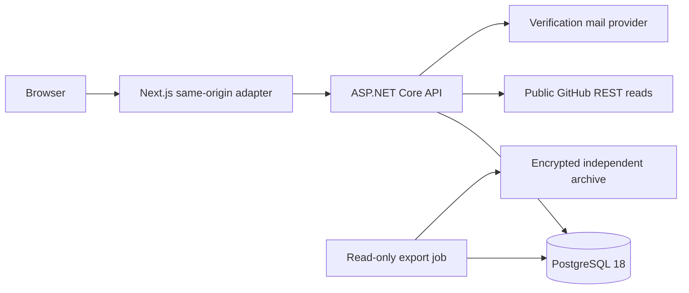
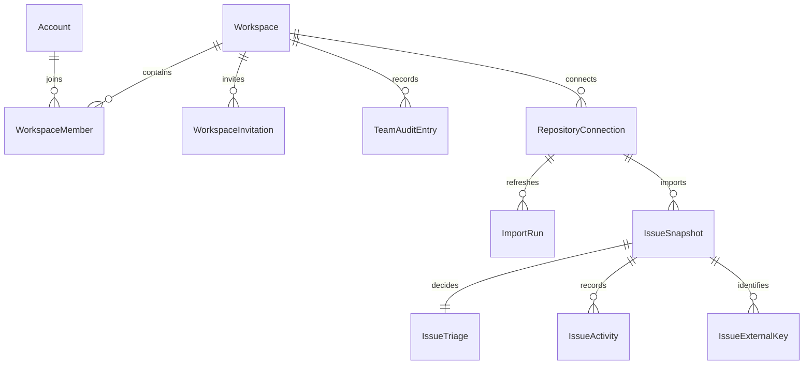

# System and data model

The adapter forwards the session and antiforgery proof to a fixed API origin. The API checks the authenticated account and current workspace membership. GitHub reads happen during authorized manual refreshes. The database owns private workflow decisions and history.

Workspace-owned relationships use workspace-scoped keys. The stable local issue ID preserves history through a verified upstream transfer. Protection keys are certificate-wrapped records shared by API instances. Source-access-loss records fence older source observations across workspaces.

[Architecture walkthrough](interview/architecture-explained.md) · [Technical decisions](interview/technical-decisions.md) · [Recovery runbook](runbooks/release-and-recovery.md)
